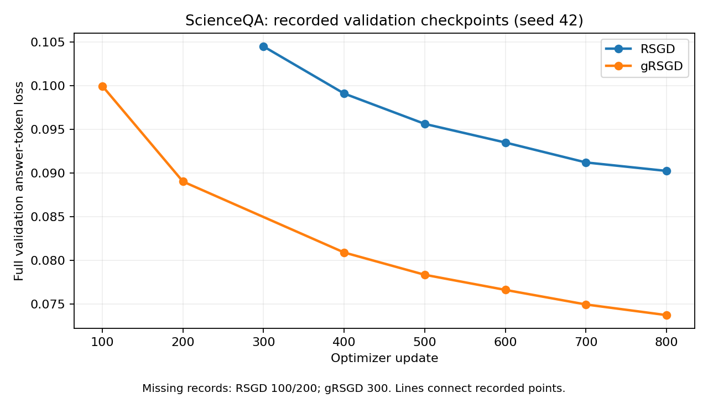

# MoE-LoRA Riemannian Reproduction

Independent **RSGD versus gate-rescaled gRSGD** experiments for Llama-3.2-3B,
based on [A Stronger Mixture of Low-Rank Experts for Fine-Tuning Foundation
Models](https://arxiv.org/abs/2502.15828) and
[the authors' code](https://github.com/THUDM/MoELoRA_Riemannian).

The study asks whether changing the expert backward gate factor from `g` to
`sqrt(g)`, while keeping forward values unchanged and using Riemannian
preconditioning, improves optimization.
[Mechanism notes](synthetic/mechanism.md) distinguish this surrogate backward
from the actual finite forward update.

[Hướng dẫn tiếng Việt](docs/workflow.vi.md) ·
[ScienceQA results](results/scienceqa/README.md) ·
[Protocol](docs/reproduction.md) · [Synthetic](synthetic/README.md)

## 1. ScienceQA: completed experiment

Text-only ScienceQA; 20 experts, Top-K 10, rank 4, alpha 16, dropout 0.05,
seed 42, 800 updates, nominal effective batch 80. Split sizes: 6,508 train,
2,144 validation, 2,224 test. Both training audits record zero examples without
supervised answer tokens.

| Method | Paper Table 1 | This run | Difference from paper | Correct / total |
| --- | ---: | ---: | ---: | ---: |
| RSGD | 62.8% | **62.54%** | −0.26 pp | 1,391 / 2,224 |
| gRSGD | 70.1% | **69.24%** | −0.86 pp | 1,540 / 2,224 |

Observed improvement: **6.70 percentage points**.
This is one seed on the text-only subset and a documented protocol variant;
it is not reproduction of the whole Table 1 or a multi-seed uncertainty estimate.
Nearby scores alone do not establish an identical evaluation protocol.

Evidence: [comparison CSV](results/scienceqa/comparison.csv),
[RSGD](results/scienceqa/runs/rsgd_seed42/summary.json),
[gRSGD](results/scienceqa/runs/grsgd_seed42/summary.json).
See [the report](results/scienceqa/README.md) for details.



Only recorded points are plotted: RSGD steps 100/200 and gRSGD step 300 are
missing from the archived histories and have not been filled in.

### Diagnostics and checkpoints

[Functional probes](results/scienceqa/diagnostics/README.md) cover 64 questions
and six projection modules. The probe backbone is FP16 on T4; training used
BF16. Outputs, manifests and configs are archived; the generating script has
not been supplied. Cosine/entropy alone does not prove specialization.

Weights stay on [Drive](https://drive.google.com/drive/folders/1758VR30_gvLQ0eZFeFKw-W2MgDtH0Tax).
[Source snapshots](results/scienceqa/source_snapshot/README.md) preserve the
code that created them.

### Start a new run

Python 3.10+, a CUDA GPU and Hugging Face access to Llama-3.2-3B:

```bash
python -m pip install -e ".[scienceqa]"
python -m moelora_repro.run --config configs/scienceqa/grsgd_k10_seed42.json --dry-run
python -m moelora_repro.run --config configs/scienceqa/rsgd_k10_seed42.json
python -m moelora_repro.run --config configs/scienceqa/grsgd_k10_seed42.json
```

[Recipes](configs/README.md) share pinned model/data revisions. New runs use
fresh ignored `outputs/` directories. The driver saves resumable checkpoints;
read [the workflow](docs/workflow.vi.md) for resume instructions.

## 2. Synthetic: independent mechanism study

Everything specific to generated regression data is in
**[synthetic/](synthetic/README.md)**: code, recipes, tests, results and notes.
These experiments isolate routing/gradient mechanisms; their MSE results are
separate from ScienceQA accuracy.

```bash
python -m pip install -e .
python -m unittest discover -s synthetic/tests -v
python -m moelora_repro.run --config synthetic/configs/smoke.json
```

## 3. Project layout

| Location | Contents |
| --- | --- |
| `src/moelora_repro/scienceqa/` | Model, optimizer, helpers and one training driver |
| `configs/scienceqa/` | Current recipes and pinned revisions |
| `results/scienceqa/runs/` | Completed configs, audits, metrics and predictions |
| `results/scienceqa/diagnostics/` | RSGD/gRSGD functional probes and figures |
| `results/scienceqa/source_snapshot/` | Original source and environment records |
| `scripts/` | Rebuild comparison CSV and validation figure |
| `synthetic/` | Entire synthetic study, including its own tests |
| `tests/` | ScienceQA and shared workflow checks |
| `docs/` | Protocol, layout and Vietnamese workflow |
| `outputs/` | Local new runs, ignored by Git |

## 4. Maintain and validate

```bash
python -m unittest discover -s tests -v
python -m unittest discover -s synthetic/tests -v
python scripts/summarize_scienceqa.py
```

Use [the experiment template](docs/experiment-template.md). Keep checkpoints,
tokens and dataset caches outside tracked files.
Earlier ScienceQA results are removed from the active tree and retained in
[archive/before-scienceqa-cleanup](https://github.com/thanhungoc2552006-debug/moelora-riemannian-reproduction/tree/archive/before-scienceqa-cleanup).
